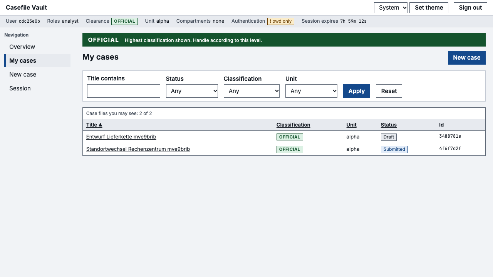
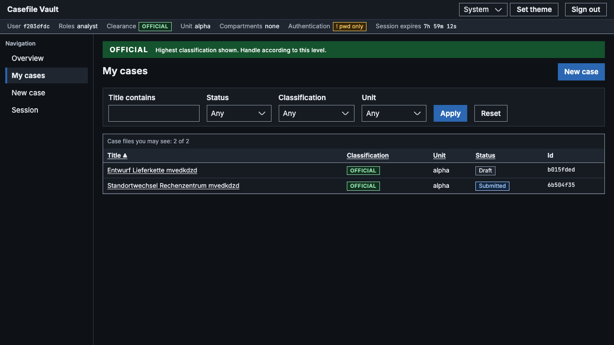
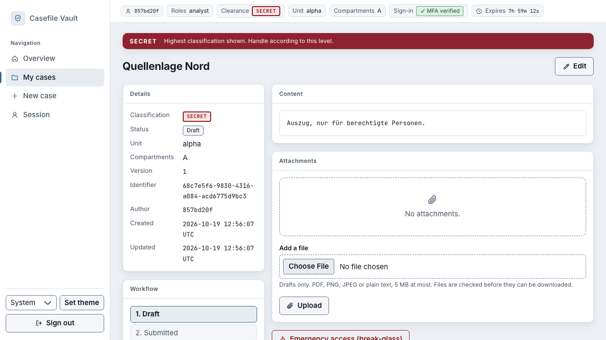
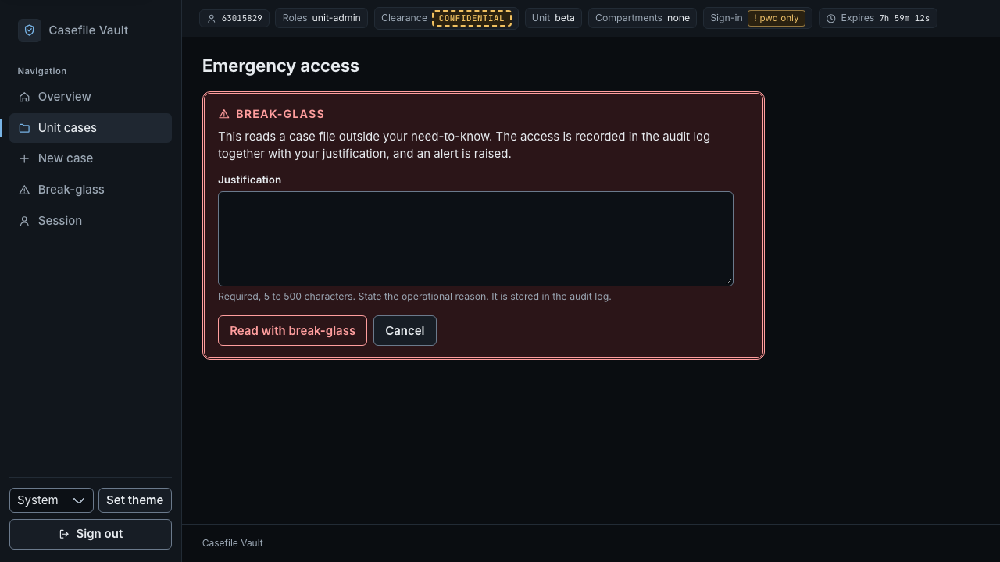
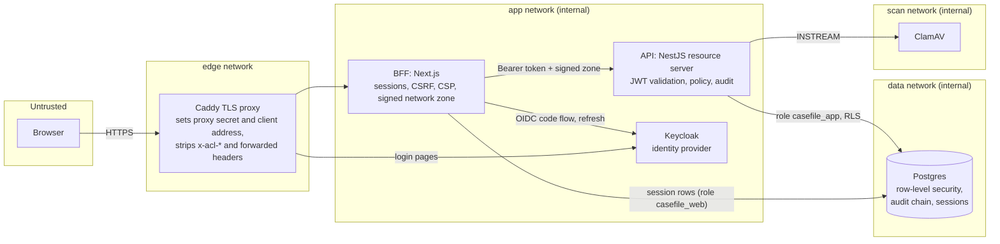

# Casefile Vault

[](https://github.com/sotream/access-control-lab/actions/workflows/ci.yml)
[](https://github.com/sotream/access-control-lab/actions/workflows/security.yml)
[](https://scorecard.dev/viewer/?uri=github.com/sotream/access-control-lab)

A security-first reference system for classified case files: who may read which file is decided by OAuth 2.0/OIDC identity, roles and per-record attributes, enforced in three independent layers, and every claim is backed by a test that tries to break it. The repository is `access-control-lab`; the product is deliberately plain (case files with attachments), because the design and the evidence are the point.

<table>
<tr><td></td><td></td></tr>
<tr><td></td><td></td></tr>
</table>

More screens, light and dark, are in [docs/screenshots](docs/screenshots) (generated by a script from the running stack, seed users only; see [docs/ui.md](docs/ui.md)).

## What this demonstrates

Each point is a control with the test that shows it works. [docs/rationale.md](docs/rationale.md) argues every design choice (problem, decision, alternatives rejected, trade-offs, proof).

- **OAuth 2.0 / OIDC with PKCE on Keycloak**: realm as code, claims for clearance, unit and compartments, TOTP step-up signalled by `acr` and `amr` ([docs/identity.md](docs/identity.md)).
- **Backend for frontend (BFF) with server-side sessions**: the browser holds only an opaque `__Host-` cookie; tokens stay encrypted on the server; CSRF scheme, CSP with nonces, allow-listed API client ([docs/bff.md](docs/bff.md)).
- **RBAC plus ABAC in one pure policy package**: default deny, deny overrides, separation of duties, break-glass, the same answer (404) for hidden and missing files ([docs/policy.md](docs/policy.md)).
- **Postgres row-level security as a second implementation of the same rules**, with parity tests against the policy package and decide-and-write in one transaction ([docs/data-layer.md](docs/data-layer.md)).
- **A tamper-evident audit log**: HMAC hash chain, database-enforced linearity, checkpoints, a verifier, auditor-only read and export ([docs/audit.md](docs/audit.md)).
- **Attachments**: the bytes decide the type, quarantine until an explicit clean verdict from ClamAV, never served inline ([docs/hardening.md](docs/hardening.md)).
- **Hardened containers and a prod-like stack**: distroless, non-root, read-only, internal networks, TLS proxy with a header contract, production profile that refuses development values ([docs/deployment.md](docs/deployment.md)).
- **Attacks and mutation checks**: a black-box attack suite with fuzzing and a ZAP baseline against the prod-like stack, a gate that ties every threat to a test, and hand-made mutants to show the tests bite ([docs/attack-catalogue.md](docs/attack-catalogue.md)); a real-browser stage for CSP, cookies and accessibility ([docs/ui.md](docs/ui.md)).

## Architecture



Trust boundaries: the browser is untrusted and holds no token. The proxy is the only published port and is the only party the BFF believes about the client address. The API trusts nothing but a validated JWT. The database enforces the read and write rules again, whatever the API sends.

## Quick start

Needs Node 24, pnpm 12 (`corepack enable`), Docker. Everything binds to `127.0.0.1`; all credentials are throwaway development values.

```sh
pnpm install --frozen-lockfile
cp .env.example .env
docker compose up -d --wait        # Postgres and Keycloak with the imported dev realm
pnpm db:migrate && pnpm db:seed    # schema, then a few demo case files
pnpm dev:api                       # API on http://127.0.0.1:3001 (second terminal)
pnpm dev:web                       # web app on http://127.0.0.1:3000 (third terminal)
```

Open http://127.0.0.1:3000 and sign in as one of the [dev users](docs/dev-users.md) (password from `.env`; the SECRET users also need a one-time code, see the same page). This sequence was run from a clean clone.

## How it is verified

| Suite | Command | Needs | What it proves |
|-------|---------|-------|----------------|
| Unit | `pnpm test` | nothing | policy matrix (coverage gate), token validation, config that fails closed, audit chain, rate limiter, UI helpers |
| Lint and guards | `pnpm lint` | nothing | eslint, invisible-character scan, threat-to-test coverage, ASVS tally, documentation links, pnpm scripts and diagrams |
| Database | `pnpm test:db` | `docker compose up -d --wait`, `.env` | row-level security and the guard trigger against real Postgres, parity with the policy package, audit chain in SQL |
| Identity | `pnpm test:identity` | same | real Keycloak: PKCE, claims, MFA, refresh rotation, lockout, API with real tokens |
| BFF | `pnpm test:bff` | same | the web app end to end over HTTP: sessions, CSRF variants, proxy allow-list, headers, escaped output |
| Prod-like | `node scripts/prod-like-test.mjs` | Docker | hardened images and networks, proxy contract, EICAR quarantine, limits, checked from outside |
| Attack | `pnpm test:attack` | Docker | the catalogued black-box attacks, fuzzing and a ZAP baseline through the proxy ([catalogue](docs/attack-catalogue.md)) |
| Browser | `pnpm test:e2e` | Docker | real Chromium: CSP violations, `__Host-` cookie, framing, storage, axe, keyboard order, the main flows |
| Nightly | workflow `attack-nightly` | CI | the attack suite with a random fuzz seed and the slow modes |
| Mutation | workflow `attack-mutation` (manual) | CI | hand-made mutants of the defences; the suite must fail for each |

Required checks on `main` (the `protect-main` ruleset): `check`, `identity`, `secret-scan`, `codeql`, `osv`, `images`, `workflows`, `prod-like`, `attack-tests`. `e2e-browser` runs on every pull request and is not required yet. `dependency-review` stays red until the repository's Dependency graph setting is enabled (a repository setting, not a code problem).

## Concepts in one minute

- **OAuth 2.0** lets an application act for a user with a token, without seeing the password. **OIDC** (OpenID Connect) adds identity on top: the ID token says who signed in. **PKCE** (Proof Key for Code Exchange) binds the authorization code to the client that asked for it, so an intercepted code is useless. This system uses the authorization code flow with PKCE.
- **Authentication** is who you are; **authorization** is what you may do.
- **RBAC** (role-based access control) attaches permissions to roles: simple and auditable, but it cannot express "only your own unit's files". **ABAC** (attribute-based access control) decides from attributes of the user, the resource, the action and the environment: clearance at least the file's classification, all of the file's compartments held, request from the managed network. Here RBAC answers "may this role do this action at all" and ABAC answers "may this person do it to this record".
- **STRIDE** (spoofing, tampering, repudiation, information disclosure, denial of service, elevation of privilege) is the checklist the [threat model](docs/threat-model.md) follows; each threat has an ID that points at a test.
- **BFF** (backend for frontend): the server-side half of the web app that holds the tokens and talks to the API on the user's behalf.

## Repository map

| Path | Contents |
|------|----------|
| `apps/api` | NestJS resource server: JWT validation, policy guard, case files, attachments, audit log, migrations |
| `apps/web` | Next.js BFF and the server-rendered console (Tailwind, self-hosted fonts) |
| `packages/policy` | pure RBAC and ABAC evaluator, read filter shared with SQL |
| `packages/audit` | HMAC hash chain, key rings, cursors, verifier |
| `packages/netguard` | rate limiter, trusted-proxy contract, signed network zone |
| `tests/` | `api-db`, `identity`, `bff`, `attack`, `e2e` suites |
| `infra/` | Keycloak realm as code, Postgres init, Caddy and ClamAV configuration |
| `scripts/` | prod-like stack setup and test, attack mutation harness, repository guards |
| `docs/` | see below |

| Document | One line |
|----------|----------|
| [rationale.md](docs/rationale.md) | why each component is built the way it is, with alternatives and proof |
| [plan.md](docs/plan.md) | product, access model, the ten stages and their status |
| [threat-model.md](docs/threat-model.md) | STRIDE analysis, one ID per threat, each mapped to a test or an accepted risk |
| [decisions.md](docs/decisions.md) | architecture decision records |
| [identity.md](docs/identity.md), [dev-users.md](docs/dev-users.md) | Keycloak realm, claims, MFA; the seeded users |
| [api-auth.md](docs/api-auth.md) | API token validation |
| [policy.md](docs/policy.md) | the access rules and the 404-versus-403 decision |
| [data-layer.md](docs/data-layer.md) | row-level security, roles, transactions |
| [bff.md](docs/bff.md) | sessions, CSRF, headers, the API client |
| [audit.md](docs/audit.md) | the hash chain, what it proves and what it cannot |
| [hardening.md](docs/hardening.md) | rate limits, network zone, production profile, attachments, key rotation |
| [deployment.md](docs/deployment.md) | images, the prod-like stack, CI jobs |
| [supply-chain.md](docs/supply-chain.md), [signed-commits.md](docs/signed-commits.md) | pinned dependencies, scanners, commit signing guidance |
| [attack-catalogue.md](docs/attack-catalogue.md) | the attacks, what each showed, the mutation check |
| [accepted-risks.md](docs/accepted-risks.md) | what is knowingly not covered, with owner and upgrade path |
| [asvs.md](docs/asvs.md) | OWASP ASVS 4.0.3 level 2 self-assessment |
| [ui.md](docs/ui.md) | design system, accessibility results, how to add a page |

## Honest limits

- It is a lab. Nothing was run in a real deployment; the prod-like stack proves the properties of its own compose file, not of a cloud.
- [docs/asvs.md](docs/asvs.md) is a self-assessment by the authors, not a certification or an audit, and its requirement numbering was not diffed against the official list.
- Known gaps are written down with an owner and an upgrade path in [docs/accepted-risks.md](docs/accepted-risks.md): for example no token revocation list (a stolen access token works for at most five minutes), no TLS between internal components, no external anchoring of audit checkpoints, no storage quota.
- What is not verified (assistive technology, other browsers, more than one replica, a real certificate authority) is listed in [docs/ui.md](docs/ui.md), [docs/deployment.md](docs/deployment.md) and [docs/asvs.md](docs/asvs.md).
- No license file is present yet: the code is public for review.
- Security reports: see [SECURITY.md](SECURITY.md).

## Status

| Stage | Subject | State |
|-------|---------|-------|
| 1 | Foundation, threat model | done |
| 2 | Identity (Keycloak) | done |
| 3 | API as resource server | done |
| 4 | Authorization policy | done |
| 5 | Data layer, row-level security | done |
| 6 | Web as BFF | done |
| 7 | Audit and integrity | done |
| 8 | Hardening, containers, supply chain | done |
| 9 | Attack tests | done |
| 10 | Frontend design and browser tests | done |
| 11 | Documentation pass and rationale | done |
