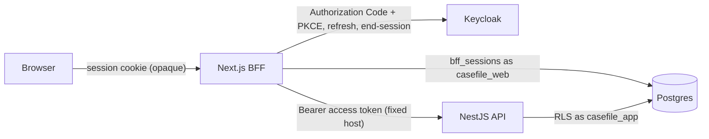
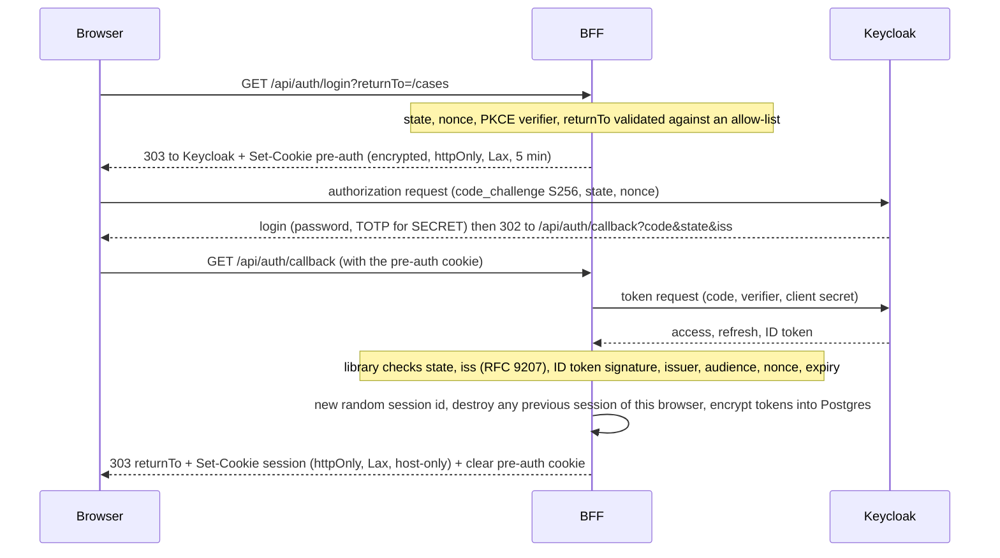

# Web as BFF (stage 6)

`apps/web` is a Next.js (App Router) application that acts as a Backend For Frontend: the browser never sees an access, refresh or ID token. It holds them
server side, behind an opaque session cookie, and calls the NestJS API on the user's behalf. The UI is functional and unstyled (plain semantic HTML; Tailwind is
installed, no design work until the last stage). Threat IDs refer to `docs/threat-model.md`. **Unverified** marks things no test covers.

## Components

Code map: `app/api/auth/*` (login, callback, logout, session), `app/bff/[...path]` (JSON proxy), `app/actions/*` (form posts), `app/*` pages,
`proxy.ts` (headers and CSP nonce), `instrumentation.ts` (refuses to start on bad configuration), `src/server/*` (config, crypto, session store, OIDC, CSRF,
redirect validation, API client).

## Login (Authorization Code + PKCE S256, confidential client `casefile-web`)

- The OIDC protocol work is done by `openid-client` (ADR-13). Keycloak sends the `iss` response parameter (`authorization_response_iss_parameter_supported`),
  and a wrong `iss` is rejected (tested).
- The pre-auth cookie is AES-256-GCM encrypted (it carries the PKCE verifier) and single use; a replayed callback fails because Keycloak codes are single use (tested).
- Step-up: a page that needs more than the session has links to `/api/auth/login?acr=mfa&returnTo=...`; only `acr=mfa` is ever forwarded as `acr_values`. A SECRET user is
  always asked for TOTP by Keycloak; for a user without TOTP, `acr=mfa` leads to enrolment, never to a code for the app (tested).

## Cookies

| Cookie | Content | Attributes | Lifetime |
|--------|---------|-----------|----------|
| `__Host-casefile_session` (`casefile_session` when `COOKIE_SECURE=false`, plain-http dev only) | 256-bit random id, nothing else | HttpOnly, Secure, SameSite=Lax, Path=/, no Domain | absolute `SESSION_ABSOLUTE_SECONDS` (8 h), idle `SESSION_IDLE_SECONDS` (30 min) enforced server side |
| `__Host-casefile_pre` (`casefile_pre`) | AES-GCM sealed `{state, nonce, verifier, returnTo, exp}` | HttpOnly, Secure, SameSite=Lax, Path=/, no Domain | 5 min, cleared at the callback |

`__Host-` pins the cookie to this host (no Domain, Path=/, Secure) and prevents overwrites from sibling subdomains. SameSite=Lax rather than Strict because the callback
is a cross-site top-level navigation from Keycloak. The page scripts never read either cookie (HttpOnly).

## Session lifecycle (`src/server/session-store.ts`, table `bff_sessions`)

- Stored: SHA-256 of the cookie value (never the value), user `sub`, a per-session CSRF token, tokens encrypted with AES-256-GCM (key ring `SESSION_ENCRYPTION_KEYS`,
  key id stored per row for rotation, AAD = the row key so a blob moved to another row does not decrypt), absolute and idle expiry. Role `casefile_web` can touch only this table;
  the API role cannot see it (tested both ways).
- **Create** at login: fresh id (a cookie planted before login is never adopted), the browser's previous session is destroyed, at most 5 sessions per user (oldest dropped, concurrent logins serialised).
- **Use**: each request looks up the session, slides the idle timeout (never past the absolute one). Unknown, malformed, expired, tampered or undecryptable: anonymous.
- **Refresh**: when the access token has less than 30 s left, the session row is locked (`FOR UPDATE`) and refreshed once; concurrent requests wait and reuse the result. Refresh token rotation is
  Keycloak's. A refused refresh (expired, revoked, **reused**) destroys the session. An attacker replaying an old refresh token makes Keycloak revoke the chain; the next refresh by the BFF
  fails and the session ends (tested end to end).
- **Logout**: `POST /api/auth/logout` only, with the CSRF token. Destroys **every** session of the user (all browsers), clears both cookies, and redirects to Keycloak's end-session endpoint with
  `id_token_hint` and the single configured `post_logout_redirect_uri` (`WEB_ORIGIN/`, exact match in the realm). After it: the old cookie is rejected, Keycloak asks for a login again, the old
  refresh token is dead (tested).

## CSRF (ADR-15)

Every state-changing route (logout, the form actions, the `/bff` writes) requires all of: `Origin` header present and equal to `WEB_ORIGIN`; `Sec-Fetch-Site`, when sent, equal to `same-origin`;
and the session's synchronizer token (hidden `csrf` form field, or `X-CSRF-Token` for JSON), compared in constant time. SameSite=Lax is the first layer, not the only one. Ten forged variants
per route are tested (no Origin, foreign Origin, `null`, other port, no token, wrong token, another user's token, cross-site, same-site, token in the query string). GET and HEAD never change state;
the action and logout routes answer 405 to GET. No CORS grant is ever sent.

## API proxy (ADR-16)

Two entry points, one client (`src/server/api.ts`): server components and form actions call it directly; `/bff/*` exposes the same calls as JSON for scripts.

| Rule | Detail |
|------|--------|
| Allow-list | exactly nine method+path pairs (`/me`, `/case-files`, `/case-files/{uuid}`, `.../submit`, `.../approve`, `.../export`); everything else is 404 before any session work |
| Fixed upstream | `API_BASE_URL` from configuration; the path is matched against the allow-list, so no host, scheme or `..` can be injected (raw traversal tested) |
| Request built from scratch | only `Authorization` (the session's token), `Accept`, `Content-Type`; no cookies, no forwarded headers, no query string, no browser headers |
| Break-glass | `X-Break-Glass-Justification` is sent only by the dedicated route `/actions/case-files/{id}/break-glass` (justification of at least 5 characters, result rendered in the response, never in a URL) |
| Limits | request body <= 64 KB JSON only (415/413/400), response <= 2 MB (else 502), 10 s timeout, redirects never followed |
| Response | status, `Content-Type`, `WWW-Authenticate` (so the UI can start a step-up, RFC 9470), `Retry-After`; everything else dropped; `Cache-Control: no-store` |

**Network zone.** The API decides export by the socket address of its caller. Behind the BFF that is the BFF's address, not the user's: the user's zone stays unproven (the stage 4 note stands). The BFF does
not forward `X-Forwarded-For` (the API ignores it anyway) because nothing in the chain could vouch for it. In dev, "managed" means "the BFF runs on a managed address".

## Security headers (`proxy.ts`, `next.config.ts`)

| Header | Value |
|--------|-------|
| Content-Security-Policy | `default-src 'none'; script-src 'self' 'nonce-<per request>' 'strict-dynamic'; style-src 'self' 'nonce-<per request>'; img-src 'self' data:; font-src 'self'; connect-src 'self'; form-action 'self'; frame-ancestors 'none'; base-uri 'none'; object-src 'none'` (+ `upgrade-insecure-requests` with HSTS). No `unsafe-inline`, no `unsafe-eval` in production; no third-party origin |
| Strict-Transport-Security | `max-age=31536000; includeSubDomains`, only when `HSTS_ENABLED` (default on for an https origin) |
| Cross-Origin-Opener-Policy / Cross-Origin-Resource-Policy | `same-origin` / `same-origin` (static assets too) |
| Referrer-Policy | `no-referrer` |
| Permissions-Policy | camera, microphone, geolocation, payment, usb, interest-cohort all denied |
| X-Content-Type-Options / X-Frame-Options | `nosniff` / `DENY` (also on static assets / legacy framing) |
| Cache-Control | `no-store` on every dynamic response (Next's own stricter value on 404 pages) |

Pages are dynamic, so each render gets a fresh nonce and Next applies it to its own scripts; the tests read real response headers of pages, route handlers, JSON, redirects and error pages.

## Pages (functional, unstyled)

`/` home, `/session` (what the API knows: roles, clearance, unit, authentication level), `/cases` (list), `/cases/new`, `/cases/{id}` (detail, edit, submit, approve, delete forms),
`/cases/{id}/break-glass` (justification form). React escapes everything; the one route handler that writes HTML itself (break-glass result) uses an escaping helper. Stored XSS payloads in title and body render inert
on every page, including attribute contexts (tested).

## Configuration

`WEB_ORIGIN`, `KEYCLOAK_ISSUER`, `OIDC_CLIENT_ID`, `CASEFILE_WEB_SECRET`, `API_BASE_URL`, `WEB_DATABASE_URL` (role `casefile_web`), `SESSION_ENCRYPTION_KEYS` (`id:base64(32 bytes)`, first encrypts), `COOKIE_SECURE`
(default true), `HSTS_ENABLED`, `SESSION_IDLE_SECONDS`, `SESSION_ABSOLUTE_SECONDS`, `MAX_SESSIONS_PER_USER`, `REFRESH_SKEW_SECONDS`. Unsafe values stop the server at startup (`instrumentation.ts`): http outside loopback, insecure cookies
on an https origin, bad key ring. The realm needs no change: the redirect URI `http://127.0.0.1:3000/api/auth/callback` and the post-logout URI `http://127.0.0.1:3000/` are the exact values already registered.

## Mutation check (by hand)

Each change below was applied alone, the web app rebuilt, and the unit suite (apps/web) or the end-to-end suite (tests/bff, `--bail 1`) run: every mutant is killed except three that are
**redundant by design** (B05 to B07: the return-to validator has layered checks, so removing the `//` check, the backslash check or the decoding round alone changes nothing, because the allow-list of
exact paths and the URL-origin check still refuse the value; B37 and B38, which remove or widen the allow-list itself, are killed). The first run also exposed two weak tests, now fixed: the CSRF
variants that were meant to send a correct Origin did not send one (so they were refused for the wrong reason), and the "redirect never followed" test could not tell a followed redirect from a refused one
(it now watches the redirect target for traffic).

- B01 csrf: Origin check removed
- B02 csrf: token never compared
- B03 csrf: Sec-Fetch-Site ignored
- B04 csrf: missing token accepted
- B05 redirect: protocol-relative allowed
- B06 redirect: backslash allowed
- B07 redirect: no decoding round
- B08 login: returnTo not validated
- B09 callback: old session kept (fixation)
- B10 callback: state check skipped
- B11 callback: pre-auth cookie not cleared
- B12 cookie: session cookie not httpOnly
- B13 cookie: SameSite none
- B14 cookie: Secure not applied
- B15 logout: only this session destroyed
- B16 logout: Keycloak session not ended
- B17 refresh: no row lock
- B18 refresh: failure keeps the session
- B19 store: raw session id stored
- B20 store: no idle check
- B21 store: no per-user cap
- B22 store: AAD not bound to the row
- B23 proxy: allow-list bypassed
- B24 proxy: upstream redirects followed
- B25 proxy: break-glass header forwarded from the browser
- B26 proxy: step-up challenge dropped
- B27 proxy: JSON writes need no token
- B28 headers: unsafe-inline in script-src
- B29 headers: frame-ancestors removed
- B30 headers: no-store removed
- B31 page leaks the access token
- B32 break-glass page unescaped
- B33 preauth: no expiry
- B34 config: insecure cookies by default
- B35 oidc: PKCE challenge method plain
- B36 session page for anyone (no session check)
- B37 redirect: allow-list widened to any path
- B38 redirect: allow-list check removed (other layers remain)

## What is NOT protected / not verified

- **A compromised BFF process or its key ring** can use every live session; encryption at rest protects a database dump, not the running server. Key rotation works (decrypt with old, encrypt with new) but there is no re-encryption job.
- **Access tokens are not revoked at the API** (accepted risk since stage 4): a stolen access token works until it expires (5 min).
- **The user's network zone** is unproven (above). **Real browsers** are not driven: the tests script the HTTP flow (cookies, redirects, forms) against the real servers; no Playwright, so JavaScript behaviour of the hydrated pages, real
  `Sec-Fetch-*` / `Origin` emission by a browser, and cookie handling quirks of `__Host-` over http are **unverified**. The Secure/`__Host-` configuration is tested for the attributes sent, not for a real https deployment (TLS termination is stage 8).
- Client-side navigation (Next prefetch) is not specifically tested; every page is dynamic and no-store.
- The real step-up round trip with a SECRET user whose session lacks `amr=otp` cannot be produced through Keycloak (TOTP is forced); the pass-through of the challenge is tested with a recording upstream and the API side in stages 4 and 5.
- No rate limiting on `/api/auth/login` and `/api/auth/callback` yet (Keycloak's brute-force protection and the API limiter cover other layers): stage 8.
- Single instance assumptions: the pool and OIDC discovery cache are per process; sessions live in Postgres so several instances work, but that is untested.
